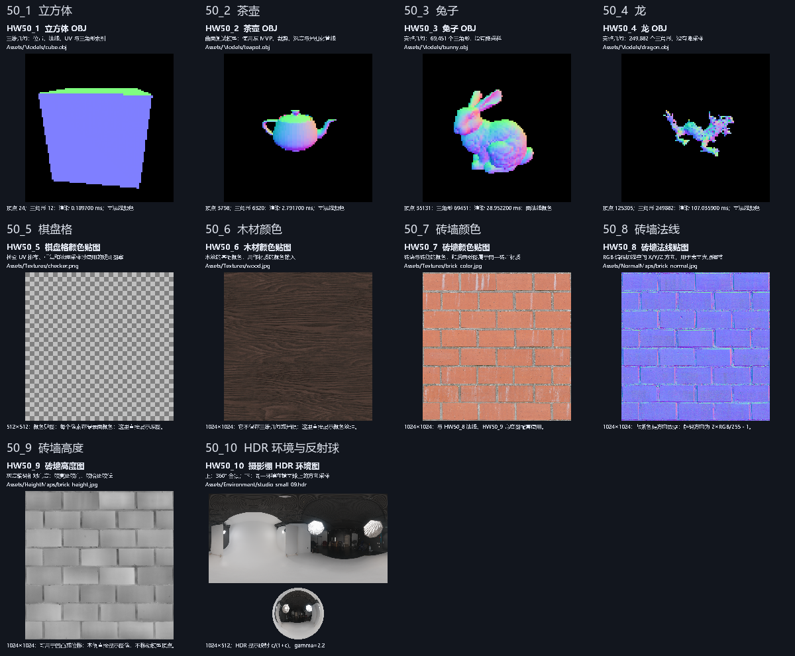

# HW50_1～HW50_10：认识并展示 Assets

这组入口专门浏览已准备好的资源，独立于原 HW01～HW50。原作业的源码、注册表、测试和完成状态不变，也没有增加 HW51、HW52。

## 如何使用

打开 [`src/Application/Config.h`](../src/Application/Config.h)，修改这一行并重新编译：

```cpp
inline constexpr int kActiveHomework = 50_1;
inline constexpr ModelDemo kActiveModelDemo = ModelDemo::None;
```

上面的示例显示立方体资源；当前 Config 保留你选择的 `50_3`（Bunny）。想看法线图就改为 `50_8`，看 HDR 环境就改为 `50_10`；想回到原作业则改为 `31` 等整数编号。

原 HW32～HW50 已在后续补齐，使用方法见 [新增章节学习指南](HW32至HW50_学习指南.md)。其中 `50` 是三线性滤波，`50_1`～`50_10` 仍是本页的独立资源展示。

**你要求的 `50_1` 原写法已支持。** `AssetHomeworkIds.h` 定义了 C++ 自定义整数字面量 `_1`～`_10`，所以 `50_10` 与 `HW50_10` 等价。前缀必须是 50；不要写 `50.10`、`5010` 或 `31_1`。内部编号仅供调度，用户选择始终使用下划线名称。

不改源码也可用启动参数切换，支持 `--hw 50_8` 和 `--hw HW50_8`：

```powershell
Set-Location 'D:\github\JGraphicsLab'
& '.\out\modular\Debug\JGraphicsLab.exe' --hw 50_1
& '.\out\modular\Debug\JGraphicsLab.exe' --hw 50_2 --animate
& '.\out\modular\Debug\JGraphicsLab.exe' --hw 50_8
& '.\out\modular\Debug\JGraphicsLab.exe' --hw 50_10

# 大模型建议 Release；四个模型都可用 --animate 旋转。
& '.\out\modular\Release\JGraphicsLab.exe' --hw 50_3 --animate
& '.\out\modular\Release\JGraphicsLab.exe' --hw 50_4 --animate

# 控制台程序不打开图形窗口；可以导出带说明的预览。
& '.\out\modular\Release\JRenderLabCLI.exe' --hw 50_10 --output out/environment.ppm
& '.\out\modular\Release\JRenderLabCLI.exe' --list
```

启动参数覆盖默认配置。Visual Studio 若残留 `--hw 12`，改 Config 后仍会运行 HW12，需清除旧参数。`--hw` 与 `--demo` 同时出现时，最后出现的选择生效。

## 编号与资源对应表

| 选择 | 文件，均位于 Assets 下 | 展示内容 |
|---|---|---|
| `50_1` | `Models/cube.obj` | 立方体模型，12 三角形 |
| `50_2` | `Models/teapot.obj` | 茶壶模型，6,320 三角形 |
| `50_3` | `Models/bunny.obj` | 兔子模型，69,451 三角形 |
| `50_4` | `Models/dragon.obj` | 龙模型，249,882 三角形 |
| `50_5` | `Textures/checker.png` | 棋盘格颜色贴图，512×512 |
| `50_6` | `Textures/wood.jpg` | 木材颜色贴图，1024×1024 |
| `50_7` | `Textures/brick_color.jpg` | 砖墙颜色贴图，1024×1024 |
| `50_8` | `NormalMaps/brick_normal.jpg` | 砖墙法线贴图，1024×1024 |
| `50_9` | `HeightMaps/brick_height.jpg` | 砖墙高度图，1024×1024 |
| `50_10` | `Environment/studio_small_09.hdr` | 摄影棚全景与环境反射球，HDR 源图 1024×512 |

每个入口有独立的 `src/Homework/HW50_N.cpp`，包含中文用途与调用说明。窗口标题和画布显示名称、编号、路径和用途。

## 这些资产分别是什么

**OBJ 模型保存物体形状。** 顶点位置与三角形索引定义几何，UV 与法线提供表面属性。四个模型经 tinyobjloader 统一索引，使用原 DrawMesh 的 MVP、六平面裁剪、光栅化和深度测试；自动居中缩放，完整提交三角形，没有降采样。彩色是模型空间面法线可视化，不是扫描模型的真实材质。

**颜色贴图保存表面颜色。** 棋盘格适合观察 UV 重复、拉伸、采样；木材和砖墙图提供相应材质的基础颜色。这里展示贴图本身，没有自动把砖墙/木材贴到 Bunny 或 Dragon 上；这些纹理不是扫描模型的专属材质。

**法线贴图保存细小表面的朝向。** `brick_normal.jpg` 是 OpenGL 正 Y 切线空间法线，三个方向分量编码在 RGB 中，解码常用 `n=2*(RGB/255)-1`。平坦处通常接近 `(128,128,255)`，所以呈蓝紫色；砖边和砖缝颜色变化代表方向变化。用于光照细节，通常不直接移动顶点。JPG 压缩会产生轻微噪声，实际着色时通常还要归一化。本入口显示原图，没有修改原作业着色器。

**高度图保存相对高低。** 较亮处通常较高，较暗处较低。图像不规定具体厘米数，真实位移大小取决于将来的尺度参数。可用高度梯度产生凹凸法线，也可驱动几何位移；本入口只展示灰度图，不移动模型顶点。

砖墙颜色、法线、高度图属于同一材质，砖块与砖缝的位置相互对应。

**HDR 环境图保存物体周围的整个空间。** 这是摄影棚的 360° 等距柱状全景，提供灯、墙和地面等环境反射与照明来源。HDR 使用线性浮点亮度，强灯数值可以大于 1，不能直接当普通 0～255 图片显示。

`50_10` 上方显示全景，下方以解析球面计算反射方向 `r=2(n·v)n-v`，然后按经纬坐标采样同一环境，让你看到环境为何会出现在反光表面。显示前使用 `c/(1+c)` 压缩亮度，再做 gamma 2.2 转换；原浮点数据仍保留。这是环境资产预览，没有给原作业添加 PBR 或阴影。

`Assets/asset_manifest.json` 是资源来源、尺寸、数量和处理过程清单，`Assets/README.md` 是说明文件，二者不是需绘制的图片或模型。

## 实现与限制

```text
Config/--hw -> InitializeApplication -> 独立 AssetHomeworkRegistry
  -> 对应 RenderHW50_N
     模型：缓存 OBJ -> 原 DrawMesh -> 100×100 软件渲染
     PNG/JPG：缓存现有 WIC 解码 -> 原图预览
     HDR：缓存 stb_image 解码 -> 曝光显示映射/反射球
  -> 独立 600×600 中文说明画布 -> WM_PAINT
```

缓存槽固定为 10，OBJ、PNG/JPG、HDR 首次解析后复用；模型动画只重新渲染，不重新读 OBJ。法线与高度图展示保留原图颜色，不擅自做 gamma 修饰。

原作业仍使用原 100×100 帧缓冲；资源画布为 600×600。OBJ 光栅化基础分辨率仍为 100×100，最近邻放大后能看到像素。这保留了原教学算法；图片预览则从解码后的原图采样到较大画布。

HDR 解码复用工程已准备的 `stb_image v2.30`，保存到 `third_party/stb`，构建无需联网。文件上限 64 MiB、单边 8192、总像素不超过 16×1024×1024；额外记录超过文件末尾的读取，拒绝截断数据。加载失败输出中文路径错误，失败缓存不会每帧重复解析。

## 编译与验收

```powershell
cmake --build out/modular --config Debug --parallel 4
cmake --build out/modular --config Release --parallel 4
ctest --test-dir out/modular -C Debug --output-on-failure
ctest --test-dir out/modular -C Release --output-on-failure
```

新增验收组 `HW50资源展示` 检查 10 个实际图像、字面量写法、命令行选择、缓存次数、HDR 浮点亮度与失败处理，以及切回原 HW31。原作业数学和画面回归继续使用原验收组。


## 本次验收结果与预览

- Debug、Release 编译成功，两种配置全部四组 CTest 通过。
- 十个资源入口均生成 600×600 图像，重复展示仅加载一次；字面量 `50_1`～`50_10` 均通过编译期检查。
- 原 HW01～HW50、原 Registry/Runner 和全部 Assets 与本次开始时逐文件 SHA-256 一致。
- Debug、Release 的 HW02～HW31 颜色/深度快照均与原基准逐字节一致；原数学检查 80 PASS、0 FAIL。
- 从不同工作目录运行 HDR 展示，以及安装后的默认 Cube 展示，均可成功导出图像。
- 全部预览已检查；图像通过与窗口相同的显示画布导出，未进行人工窗口交互测试。



总览仅为最近邻缩小排版，窗口实际展示尺寸为 600×600。完整独立图像位于 `out/modular/validation/Release/assets/HW50_N.png`。
