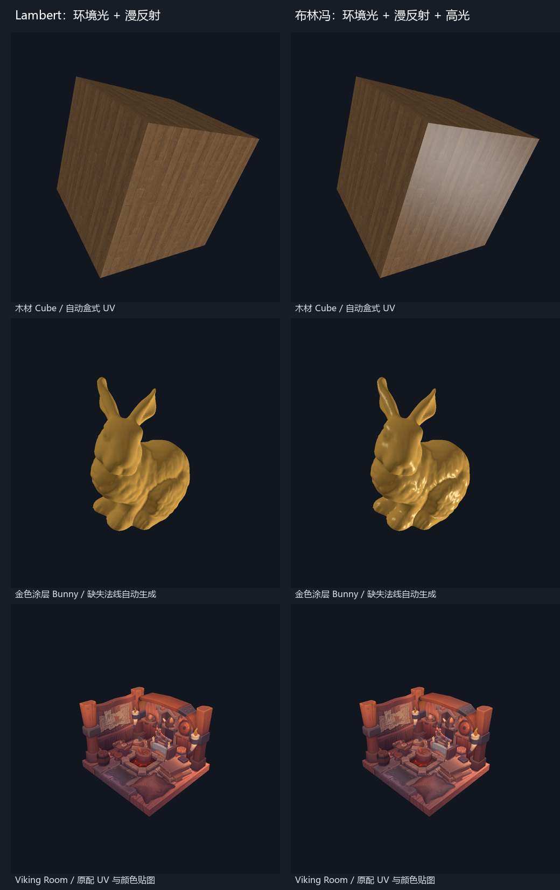

# OBJ、材质贴图与经典光照使用

当前已接通真实的 `OBJ → Mesh/MTL/Texture → Model/View/Projection → 裁剪 → 透视除法 → 光栅化 → 深度测试 → Lambert/布林冯 → 1000×1000 图像`。你的 Light/Material 核心光照公式保留；补齐了剩余渲染接口、资源读取和窗口选择，不再需要你填写前一份文档中的空框架。

## 直接运行与选择

在 Visual Studio 打开仓库根目录的 CMake 工程，生成并运行 `JGraphicsLab`。当前这台电脑的日常 Debug 程序位于：

```text
D:\github\JGraphicsLab\out\build\x64-debug\JGraphicsLab.exe
```

默认显示木材 Cube，使用布林冯光照。窗口上方有三个菜单：

- **模型**：Cube、Triangle、低多边形模型、Bunny、Viking Room。
- **材质**：OBJ 原材质、木材、砖墙、岩石、金色涂层、纯灰色。
- **光照模型**：Lambert、布林冯；也可以按键盘 **1 / 2** 切换。

切换光照立即重绘，不重新读取 OBJ、MTL 或贴图。切换到另一个模型时替换当前模型缓存；切换到另一个材质时替换当前材质缓存。缓存有界，不在每帧或每像素解析磁盘资源，也不预加载全部大模型。

切换 Viking Room 时自动选用它的原配材质；切换其他模型后可以继续选菜单中的表面材质。图像实际分辨率始终是 1000×1000，窗口缩放只是显示缩放。

## 用代码修改启动默认值

只需修改 `src/application/Renderer.h` 并重新编译：

```cpp
inline constexpr const char *kDefaultModelPath = "assets/models/cube.obj";
inline constexpr LightingModel kDefaultLightingModel = LightingModel::BlinnPhong;
inline constexpr const char *kDefaultMaterial = "wood";
```

把光照改成 `LightingModel::Lambert` 即默认显示漫反射。模型可以给完整 OBJ 路径；材质可填 `auto / wood / brick / stone / gold / plain` 或独立 MTL 路径。相机、模型矩阵、FOV、Near/Far 和主光/补光仍可在 `src/application/Renderer.cpp` 调整。

## 命令行与 PNG 导出

以下是 PowerShell 示例；工作目录可以不是项目目录。模型与预设资源会优先从程序旁 assets 查找，其次从编译时源资产目录查找。

```powershell
$exe = 'D:\github\JGraphicsLab\out\build\x64-debug\JGraphicsLab.exe'

# 木材 Cube，Lambert，显示窗口并导出启动时的画面。
& $exe --model cube --material wood --lighting lambert --output 'D:\github\JGraphicsLab\out\renders\cube-lambert.png'

# 同一对象换成布林冯，观察高光。
& $exe --model cube --material wood --lighting blinn-phong --output 'D:\github\JGraphicsLab\out\renders\cube-blinn.png'

# 金色兔子，适合比较两种光照的高光差异。
& $exe --model bunny --material gold --lighting blinn-phong

# 房间使用配套 UV 和贴图，离线渲染，不打开窗口。
& $exe --headless --model room --material auto --lighting blinn-phong --output 'D:\github\JGraphicsLab\out\renders\room.png' | Out-Host
```

`--headless` 适合导出和计时。PowerShell 运行 GUI 可执行程序需要等待完成时，可像最后一例那样接 `| Out-Host`。`--output` 保存启动时的图像，支持 `.png` 和 `.ppm`；会创建输出父目录，窗口中后续切换的画面不会自动覆盖该文件。若需保存另一个组合，用对应参数再次运行。

| 参数 | 可选值或作用 |
|---|---|
| `--model` | `cube / triangle / icosahedron / bunny / room` 或 OBJ 路径 |
| `--lighting` | `lambert / blinn-phong`；另有 `unlit / normal` 调试对照 |
| `--material` | `auto / wood / brick / stone / gold / plain` 或 MTL 路径 |
| `--texture` | 独立颜色贴图路径，覆盖替换材质的颜色图 |
| `--shading` | `phong` 默认逐像素；另有 `flat / gouraud` 学习对照 |
| `--headless` | 渲染后直接退出，不创建窗口 |
| `--output` | 输出 PNG/PPM 的路径 |
| `--basic` | 使用原六色面色管线做回归对照，不启用材质和光照 |

指定自定义 OBJ 而未指定材质时，命令行默认采用 `auto`；内置简单模型默认材质由头文件控制。独立纹理覆盖会使用一份整体替换材质，不会把同一张图片强行套到多个原配材质槽。

## 自己的 OBJ、MTL 和图片怎么放

推荐目录：

```text
assets/
  models/你的模型/
    model.obj
    material.mtl
    textures/
      albedo.jpg
      specular.png       # 可选
```

OBJ 中声明 `mtllib material.mtl`，面前声明 `usemtl sample`；MTL 例如：

```text
# 学习用经典材质
newmtl sample
Ka 0.15 0.15 0.15
Kd 1 1 1
Ks 0.35 0.35 0.35
Ns 48
map_Kd textures/albedo.jpg
map_Ks textures/specular.png
```

没有高光图就删除 `map_Ks` 这一行。MTL 相对 OBJ 所在目录查找；图片相对其所属 MTL 所在目录查找，支持中文路径、负 OBJ 索引、多份 MTL、独立位置/UV/法线索引和逐三角形材质编号。

```powershell
& $exe --model 'D:\我的模型\model.obj' --material auto --lighting lambert

# OBJ 没有 mtllib 时，也可以显式用独立材质覆盖整个模型。
& $exe --model 'D:\我的模型\model.obj' --material 'D:\我的材质\material.mtl' --lighting blinn-phong

# 只替换颜色贴图；基础系数仍来自 plain 预设。
& $exe --model bunny --material plain --texture 'D:\我的贴图\albedo.png' --lighting blinn-phong
```

独立 MTL 覆盖选择文件中的**第一个材质**，应用于整个模型；`auto` 则保留 OBJ 的 `usemtl` 分配。找不到 OBJ/MTL/图片会给出含路径的中文错误，不用白图假装加载成功。

## 两种模型具体算什么

`Material::EvaluateTerms` 是唯一的光照公式实现；光栅器不重复写 Lambert 或布林冯公式。符号 `⊙` 对应 `Vec3::Hadamard`。

```text
N = 单位世界法线
L = 从表面指向光源的单位方向
V = 从表面指向相机的单位方向
H = normalize(L+V)
B = baseColor ⊙ 颜色贴图(uv)          // 无图时 B=baseColor
I = 光源颜色 × 强度 × 距离衰减

环境项 = ambient ⊙ B                // 全场景只加一次
漫反射 = Σ diffuse ⊙ B ⊙ I × max(0,N·L)
高光项 = Σ specular ⊙ 高光图 ⊙ I × pow(max(0,N·H),shininess)

Lambert  = 环境项 + 漫反射
布林冯   = 环境项 + 漫反射 + 高光项
```

背光不加高光；零法线/半程向量不会除零。MTL 的 Kd 放在 baseColor，diffuse 设为 1，避免把 Kd 乘两遍；Ka、Ks、Ns 分别映射环境系数、高光系数和布林冯指数，Ns 最低为 1。Ka/Kd/Ks 按线性系数使用。颜色贴图先解码 sRGB，高光图作为线性数据读取，最终只在写像素时编码一次 sRGB。

`--shading phong` 表示插值世界位置、法线和 UV 后，每个可见像素求光照；`--lighting blinn-phong` 表示使用哪一种公式，两者是不同概念。

## 现有资产的真实情况

| 模型 | 本次处理 |
|---|---|
| Triangle | 原有 UV/法线直接使用，可以切换颜色材质 |
| Cube | 保留原有法线，缺失 UV 在内存中生成盒式投影 |
| 低多边形模型 | 保留原法线，缺失 UV 生成盒式投影；原法线只有 ±Y，不是完整球面平滑法线 |
| Bunny | 69,451 个原始三角形全部参与；缺失法线生成面积加权平滑法线，缺失 UV 生成盒式投影 |
| Viking Room | 新增配套 OBJ 与 PNG，补一份匹配 `usemtl Texture1` 的 MTL；使用原 UV/法线 |

前三张表面图为 [Poly Haven CC0 资产](https://polyhaven.com/license)。Viking Room 是 nigelgoh 的 CC BY 4.0 作品，来源见 [Khronos 官方教程](https://docs.vulkan.org/tutorial/latest/08_Loading_models.html)。具体来源、作者、许可、改动与下载校验见 [资产来源与许可](../assets/资源来源与许可.md)。

这些木纹/砖墙/石纹是通用材质，不是 Bunny 的“原皮肤”。盒式投影可能出现接缝，适合学习采样与光照；完整艺术纹理仍需要模型自身正确的 UV 展开。Viking Room 颜色图已经烘焙明暗，不能用它判断纯光照公式是否物理正确。

## 代码调用流程与调试位置

```text
application/main.cpp
  ParseArguments / SelectScene          参数或菜单选择
  -> RenderScene(SceneSettings)
       -> OBJLoader::LoadAsset         仅模型切换时；OBJ/MTL/纹理缓存
       -> OBJLoader::LoadMaterial      仅整体替换材质改变时
       -> DrawModelShaded
            -> 世界位置与法线逆转置
            -> ClipTriangleToFrustum
            -> Transform::ToScreen
            -> RasterizeTriangleShaded
                 -> 共用覆盖/Top-left/深度/透视插值循环
                 -> Material::Evaluate
                      -> BaseColorAt -> Texture::Sample
                      -> EvaluateTerms -> Light::DirectionFrom / RadianceAt
                 -> EncodeLinearColor -> PutPixel
  -> 窗口显示 Raster::Pixels / PNG 导出
```

想看颜色从哪里来，在 `Material::BaseColorAt` 看基色和贴图采样，在 `EvaluateTerms` 看 `ambient/diffuse/specular` 三项；想检查高光，看 `N、L、V、H、ndotl、ndoth、specularFactor`。你写的两个函数文件已统一为 UTF-8，以匹配 CMake 的 `/utf-8`。

## 验证与性能记录

Debug、Release 构建及四项 CTest 均通过：原 OBJ/变换/覆盖/深度测试、真实程序入口、经典光照/材质贴图链路、配套房间 OBJ/MTL/PNG。测试还检查了多材质分配、中文路径、共享贴图、sRGB/线性区别、负 UV、PNG 上下方向、缺失文件、非法材质编号及切换光照不重读资源。

实际窗口另外验证了 Lambert/布林冯菜单、勾选状态、Bunny/Room 模型切换、gold 材质切换和正常退出。日常 `out/build/x64-debug` 也已重新构建，四项测试全部通过。

为兼容较大单位的模型，求法线逆转置前先消去模型线性部分的整体正尺度，再调用原有公共算法；法线归一化后方向不变。新增用例检查了原坐标为一万单位、缩放为万分之一的三角形，不会被绝对行列式阈值误判为奇异。

从 `C:\Windows\Temp` 启动五个模型，分别输出两种光照，所有图均为真实 1000×1000，且确认有像素差异。另检查木材/砖墙/岩石切换及非法命令行参数。

本机 Release 单次测量，单位毫秒；数值随 CPU、缓存、后台任务变化，不能直接视为稳定帧率。加载列包括 OBJ 及其原配 MTL/贴图；额外选择的替换材质/贴图会独立加载并输出计时，不包含在该列或绘制时间内。

| 模型/材质 | OBJ 资源加载 | Lambert 绘制 | 布林冯绘制 |
|---|---:|---:|---:|
| Cube / 木材 | 0.18～0.19 | 217.53 | 226.08 |
| Triangle / 砖墙 | 0.15～0.19 | 27.58 | 28.39 |
| 低多边形 / 岩石 | 0.16～0.18 | 80.46 | 81.42 |
| Bunny / 金色 | 55～59 | 107.39 | 112.57 |
| Viking Room / 原配 | 47～48 | 110.49 | 122.15 |

Bunny 没有删除几何或降采样。绘制时间受屏幕覆盖像素和材质计算影响，因此三角形少的 Cube 也可能比 Bunny 慢。



## 当前边界

- 目前是单样本、不透明、透视相机的经典光栅化；不加入光追、PBR、透明混合、阴影或法线贴图。
- 默认逐像素光照与基础级双线性；Mipmap/三线性辅助函数已实现，但没有自动计算每像素纹理 LOD。
- MTL 支持 Ka/Kd/Ks/Ns、map_Kd、map_Ks；颜色图支持 -s/-o/-clamp。高光图暂共用颜色图的 UV 变换与地址模式，不支持独立的一套贴图变换；其他 PBR/凹凸/透明字段不参与渲染。
- PNG/JPEG/BMP 等使用系统 WIC。贴图文件最多 64 MiB、单边最多 2048；超限明确报错，不偷偷缩图。单份资源最多 16 张图、128 MiB 常驻线性像素；OBJ 最多 64 MiB、50 万三角形、150 万统一顶点，原始位置最多 50 万。
- 缺失法线采用按原位置索引的平滑平均，暂不根据 OBJ 的 `s` 标签重新划分平滑组；带法线时优先保留原法线与硬边。
- Cube 的原绕序面法线与文件 `vn` 方向相反：默认 Phong 使用原 `vn` 正常显示；切到 Flat 会暴露这个资产问题。低多边形模型原法线也不适合平滑效果比较。未修改这些原文件来掩盖差异。
- 缓存当前模型和当前替换材质；切换到别的模型再切回会重新加载，避免无限增长的资源缓存。

## Git 与资产同步

新资产、材质、来源说明、下载清单、代码和文档都要加入你的手动提交；`out` 下程序和验证图仍属于构建输出。现有 `.gitignore` 已允许 `assets/**`，包括 OBJ。

```powershell
git status --short --untracked-files=all -- assets
git check-ignore -v --no-index assets/models/viking_room/viking_room.obj
```

如果资产文件丢失，可使用系统 Python 运行 `tools/重新下载示例资产.py`，按清单校验后恢复五个下载文件；日常构建和运行不执行下载。材质 MTL 和许可文件仍由 Git 同步。

本次没有执行 Git 暂存、提交或推送。
