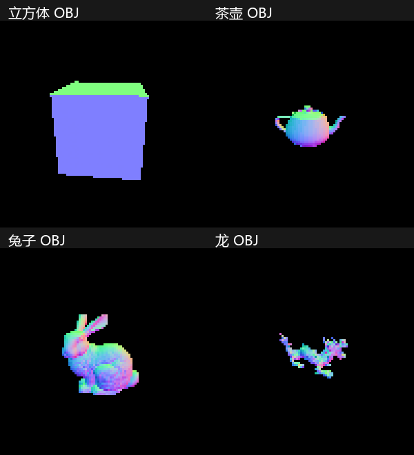

# 模块化重构验收记录

本页记录此前模块化重构阶段的结果。HW32～HW50 已在后续补齐，最新两种配置的五组测试结果、142 项数学检查及逐章图像见 [HW32～HW50 补齐验收记录](HW32至HW50_验收记录.md)。

验收日期：2026-10-13（上海时间）。工程根目录：`D:\github\JGraphicsLab`。

## 编译与测试

使用 Visual Studio 2022、MSVC 19.44.35211、Windows SDK 10.0.26100.0、C++20。CMake 使用 Visual Studio 17 2022 的 x64 多配置生成器。

- Debug 与 Release 的静态库、Win32 窗口程序、控制台程序和测试程序均编译成功。
- 两种配置的三组 CTest 全部通过：数学/调度/回归、Cube/Teapot、Bunny/Dragon。
- 全部 18 个已有数学测试入口共有 **80 项检查，80 PASS、0 FAIL**。其中原 HW15 的无条件 `check(true)` 改为检查真实像素，其余原测试条件保留；测试辅助输出实际值和预期值。
- Registry 共 50 条记录；显式 switch case 与记录逐项对应，编号从 1 到 50 唯一且无冲突。无效编号和未实现作业的退出码均为 1。
- Debug 先验证 Cube 与 Teapot 后才尝试 Bunny 与 Dragon；全部保留完整三角形数量。
- 从 `D:\github\JGraphicsLab\out` 启动工程程序仍能加载模型，并成功向中文文件名导出图像。安装到 `out/package` 后，从 `D:\github` 启动部署版也成功加载 Cube。
- PNG 与 JPEG 解码、缺失文件、非法位置/UV/法线索引、UV 接缝、负索引、多边形三角化、加载预算、非有限坐标、退化三角形与重复渲染缓存检查全部通过。

## 算法与画面保留

以开始时包含用户未提交修改的源码为基准，保存了 `out/refactor_baseline/*.original`。函数体记号审计确认 **79 个原函数原样迁移**，仅 `DrawSolidCubeMVP` 改为组织原来的 Mesh 场景并调用 `DrawMesh`。四个颜色函数和帧缓冲的原有实现也从 main 搬入公共模块。

在重构前运行原文件，生成 HW02～HW31 的颜色及深度二进制快照。重构后先检查基准哈希，再在本机对 Debug、Release 的全部 30 个快照逐字节比较：**两种配置均为 30/30 完全一致**。HW29、HW30、HW31 的默认角度、颜色、坐标和遮挡均保持原输出。

原始快照和算法审计记录保存在 `out/refactor_baseline`；可复现的哈希基准保存在 `tests/GoldenFrames.h`，不需要保留旧 Renderer 的第二套实现。

| 作业 | 颜色与深度合并基准 FNV-1a 64 位值 |
|---|---|
| HW29 | 1221929957472819781 |
| HW30 | 17380154255843150602 |
| HW31 | 2233606724207461829 |

## 模型加载和渲染耗时

以下为一次本机验收测量，不是稳定性能承诺。渲染统计是 `DrawMesh` 中的 CPU 管线时间，不含窗口呈现；加载时间包括文件读取、预算检查、tinyobjloader 解析和统一顶点映射，不含包围盒初始化。后续平均值为三个不同角度的帧。Debug 大模型计时期间也有 Release 编译活动，存在调度干扰；Release 测量在编译完成后进行。两种配置的图像都是原始 100×100 分辨率。

| 配置 | 模型 | 统一顶点数 | 三角形数 | 加载 ms | 首帧 ms | 后三帧平均 ms | 可见像素 | 加载次数 |
|---|---|---:|---:|---:|---:|---:|---:|---:|
| Debug | cube | 24 | 12 | 1.171 | 0.463 | 0.260 | 1969 | 1 |
| Debug | teapot | 3798 | 6320 | 103.813 | 31.722 | 31.011 | 374 | 1 |
| Debug | bunny | 35131 | 69451 | 1203.650 | 343.977 | 340.686 | 860 | 1 |
| Debug | dragon | 125305 | 249882 | 4578.880 | 1230.520 | 1263.130 | 272 | 1 |
| Release | cube | 24 | 12 | 0.273 | 0.170 | 0.143 | 1969 | 1 |
| Release | teapot | 3798 | 6320 | 20.417 | 2.853 | 2.951 | 374 | 1 |
| Release | bunny | 35131 | 69451 | 180.854 | 29.235 | 30.142 | 860 | 1 |
| Release | dragon | 125305 | 249882 | 676.224 | 103.525 | 102.363 | 272 | 1 |

资源清单中的文件顶点数为 Cube 24、Teapot 3808、Bunny 35132、Dragon 125307。统一 Mesh 只收录三角形实际引用的属性组合，因此其中的未引用或重复组合不会产生额外顶点；三角形数与原资源清单全部一致。没有更改模型文件，也没有降采样。



预览由程序输出的 PPM 转成 PNG，采用最近邻放大便于查看，没有对输出做平滑或着色修饰。图中颜色是模型空间面法线的简单可视化。

## 未实现功能与已知限制

HW01 的 README 虽勾选完成，但当前源码没有入口或作业算法，故明确标为未实现。在本页对应的初次重构阶段，HW32～HW50 全部未实现；后续已补齐，见页首最新记录。HW12 是单像素遮挡演示；HW14 只有二维颜色 MSAA，没有独立采样深度。初次重构新增加载器与面法线展示不自动代表后续作业完成。

保留原二维函数的边界输入行为，不借重构修正作业算法。保留 100×100 分辨率、单线程全局帧缓冲、固定角度 HW29/HW31 的默认输出。窗口程序已编译，验收图像通过与窗口相同的帧缓冲及管线导出；没有进行人工窗口交互测试。

本阶段不处理 MTL 材质、OBJ 点/线图元、不采样纹理、不实现三维 MSAA、HDR、法线矩阵、透视正确 UV 插值、光照、PBR 或阴影。WIC 纹理解码只是资源基础设施。完整限制和使用方法见 [重构与使用](重构与使用.md)。

## 新增及修改文件

本次新增源码、头文件、测试和依赖文件如下。Assets 在本次开始前已经存在且未跟踪，本次只复用，不重新生成。

```text
src/Core/Color.cpp
src/Core/Color.h
src/Core/Math.cpp
src/Core/Math.h
src/Geometry/Geometry.cpp
src/Geometry/Geometry.h
src/Geometry/Mesh.cpp
src/Geometry/Mesh.h
src/Geometry/Primitives.h
src/Renderer/Clipping.cpp
src/Renderer/Clipping.h
src/Renderer/DepthBuffer.cpp
src/Renderer/DepthBuffer.h
src/Renderer/Framebuffer.cpp
src/Renderer/Framebuffer.h
src/Renderer/Interpolation.cpp
src/Renderer/Interpolation.h
src/Renderer/MSAA.cpp
src/Renderer/MSAA.h
src/Renderer/MeshRenderer.cpp
src/Renderer/MeshRenderer.h
src/Renderer/Rasterizer2D.cpp
src/Renderer/Rasterizer2D.h
src/Renderer/Rasterizer3D.cpp
src/Renderer/Rasterizer3D.h
src/Camera/Camera.cpp
src/Camera/Camera.h
src/Camera/Transforms.cpp
src/Camera/Transforms.h
src/Assets/ObjLoader.cpp
src/Assets/ObjLoader.h
src/Assets/ResourcePaths.cpp
src/Assets/ResourcePaths.h
src/Assets/TextureLoader.cpp
src/Assets/TextureLoader.h
src/Homework/DemoData.cpp
src/Homework/DemoData.h
src/Homework/Entries.h
src/Homework/HW01.cpp
src/Homework/HW02.cpp
src/Homework/HW03.cpp
src/Homework/HW04.cpp
src/Homework/HW05.cpp
src/Homework/HW06.cpp
src/Homework/HW07.cpp
src/Homework/HW08.cpp
src/Homework/HW09.cpp
src/Homework/HW10.cpp
src/Homework/HW11.cpp
src/Homework/HW12.cpp
src/Homework/HW13.cpp
src/Homework/HW14.cpp
src/Homework/HW15.cpp
src/Homework/HW16.cpp
src/Homework/HW17.cpp
src/Homework/HW18.cpp
src/Homework/HW19.cpp
src/Homework/HW20.cpp
src/Homework/HW21.cpp
src/Homework/HW22.cpp
src/Homework/HW23.cpp
src/Homework/HW24.cpp
src/Homework/HW25.cpp
src/Homework/HW26.cpp
src/Homework/HW27.cpp
src/Homework/HW28.cpp
src/Homework/HW29.cpp
src/Homework/HW30.cpp
src/Homework/HW31.cpp
src/Homework/HW32.cpp
src/Homework/HW33.cpp
src/Homework/HW34.cpp
src/Homework/HW35.cpp
src/Homework/HW36.cpp
src/Homework/HW37.cpp
src/Homework/HW38.cpp
src/Homework/HW39.cpp
src/Homework/HW40.cpp
src/Homework/HW41.cpp
src/Homework/HW42.cpp
src/Homework/HW43.cpp
src/Homework/HW44.cpp
src/Homework/HW45.cpp
src/Homework/HW46.cpp
src/Homework/HW47.cpp
src/Homework/HW48.cpp
src/Homework/HW49.cpp
src/Homework/HW50.cpp
src/Homework/Registry.cpp
src/Homework/Registry.h
src/Homework/Runner.cpp
src/Homework/Runner.h
src/Homework/TestSupport.cpp
src/Homework/TestSupport.h
src/Application/Application.cpp
src/Application/Application.h
src/Application/Config.h
src/Application/ConsoleMain.cpp
src/Application/ModelDemos.cpp
src/Application/ModelDemos.h
src/Application/RasterWindow.cpp
tests/GoldenFrames.h
tests/IntegrationTests.cpp
third_party/tinyobjloader/LICENSE
third_party/tinyobjloader/README.md
third_party/tinyobjloader/tiny_obj_loader.h
.clang-format
docs/函数迁移.md
docs/重构与使用.md
docs/验收记录.md
docs/images/模型预览.png
```

修改文件：

- `CMakeLists.txt`：公共静态库、双入口、CTest、固定离线依赖、资源安装规则。
- `src/Renderer.cpp`、`src/main.cpp`：迁移后的学习导航文件。
- `src/RasterWindow.h`：保留原 Raster 接口的兼容头。
- `.gitignore`：保留用户已有规则，补充实际根目录 OBJ 源文件例外，防止资源被当成编译产物忽略。
- `README.md`：仅追加模块化使用说明入口，保留原作业清单和用户修改。

没有提交 Git commit，没有删除原资源；所有修改留在当前工作区供审阅。
